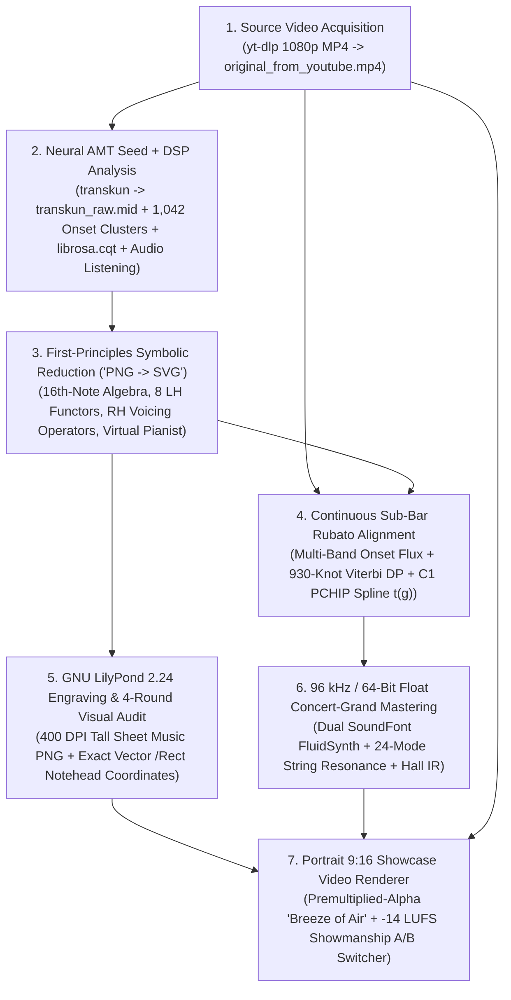

# How to Build This Yourself with OpenRouter: End-to-End Agentic Blueprint

This guide explains how **Natan** (or anyone with an [OpenRouter](https://openrouter.ai/) API key) can reproduce this entire workflow from scratch on **any piano performance video**—going from a raw YouTube URL to:
1. A **first-principles symbolic piano reduction** ("PNG → SVG" / Kolmogorov-compressed Python DSL in ~400 bytes of underlying musical logic),
2. **Continuous sub-bar dynamic rubato synchronization** (locking every MIDI note and pedal event to the performer's exact millisecond timing via Viterbi dynamic programming + $C^1$ Hermite splines),
3. **Publication-grade GNU LilyPond sheet music** (`extraordinary_sheet_music.png`) with exact vector `/Rect` notehead coordinates and zero notation collisions,
4. **96 kHz / 64-bit float dual-SoundFont physical concert-grand mastering** (`extraordinary.mp3`), and
5. A **portrait mobile (`1080 × 1920`, `9:16`) showcase video** (`extraordinary_showcase.mp4`) featuring **ITU-R BS.1770-4 loudness-matched Showmanship A/B audio switching** and a **Premultiplied-Alpha "Breeze of Air"** sheet-music visualizer—all reproducibly built inside a CPU-pinned Docker container.

---

## 1. Choosing Models & Setting Up Your OpenRouter Agent

To replicate a multi-stage music-theory + DSP + visual-engraving + video-rendering project without losing context or settling for brittle approximations, your setup needs **three things**:
1. **High Reasoning Effort (`reasoning.effort = "high"`)** so the model plans multi-step DSP verification, voice-leading invariants, and coordinate math before writing code.
2. **Large Context (`200k – 1M` tokens)** so the full 100+ bar symbolic score, onset tables, and visual inspection findings stay in working memory.
3. **Multimodal Vision (and optionally Native Audio Input)** so the agent can **look at its own rendered sheet music strips and video frames** to catch notation collisions, clipped margins, or HUD overlaps—and listen directly to audio slices if supported.

### Recommended OpenRouter Models by Role

| Model ID on OpenRouter | Context | Best Used For | Key Multimodal / Reasoning Capabilities |
| :--- | :---: | :--- | :--- |
| `google/gemini-2.5-pro` *(or latest `google/gemini-3.1-pro-preview`)* | `1,048,576` | **End-to-End Driver + Native Audio & Vision** | Accepts raw base64 `.mp3`/`.wav` audio (`input_audio`) **and** high-res images (`image_url`) + `reasoning: {"effort": "high"}` across a 1M context window. |
| `anthropic/claude-opus-4.6` *(or `anthropic/claude-sonnet-4.6`)* | `200k – 1M` | **Symbolic DSL Architecture, LilyPond Engraving & Visual Frame Auditing** | Exceptional at refactoring repetitive bars into compositional functors, auditing 400-DPI sheet music crops, and writing clean multiprocessing/Pillow/SciPy code. |
| `openai/gpt-5` *(or `openai/o3`)* | `200k+` | **DSP Math, Viterbi Alignment & Invariant Verification** | Strong at designing dynamic-programming cost matrices, K-weighted LUFS filters, and strict assertion suites. |

---

### Option A: Use an Existing CLI / IDE Coding Agent with OpenRouter

Any agentic coding harness that gives the model **Bash execution**, **File read/write**, and **Image viewing** works out of the box with OpenRouter:

1. **OpenCode / Aider / Cline / Roo Code**:
   ```bash
   export OPENROUTER_API_KEY="sk-or-v1-..."
   export OPENAI_API_BASE="https://openrouter.ai/api/v1"
   export OPENAI_API_KEY="$OPENROUTER_API_KEY"
   ```
   - In **Cline / Roo Code**: Select **OpenRouter** as the provider, choose `google/gemini-2.5-pro` or `anthropic/claude-opus-4.6`, and enable **High Thinking / Reasoning**.
   - In **Aider**:
     ```bash
     aider --model openrouter/google/gemini-2.5-pro --thinking-tokens 32000
     ```
2. **Claude Code via OpenRouter**:
   ```bash
   export ANTHROPIC_BASE_URL="https://openrouter.ai/api"
   export ANTHROPIC_AUTH_TOKEN="$OPENROUTER_API_KEY"
   export ANTHROPIC_API_KEY=""
   claude
   ```

---

### Option B: Standalone Minimal Python OpenRouter Agent (With Multimodal Vision + Native Audio)

If you want full programmatic control (including sending **both audio chunks and high-resolution sheet-music/video images** directly to `google/gemini-2.5-pro` or `anthropic/claude-opus-4.6` on OpenRouter), drop this self-contained script into `/tmp/openrouter_agent.py` and run it against your workspace:

```python
#!/usr/bin/env python3
"""Minimal self-contained OpenRouter Agent with Bash, File I/O, Vision (PNG/JPG), and Audio (MP3/WAV)."""
import base64, json, mimetypes, os, subprocess, sys
from pathlib import Path
from openai import OpenAI

MODEL = os.environ.get("OPENROUTER_MODEL", "google/gemini-2.5-pro")
client = OpenAI(
    base_url="https://openrouter.ai/api/v1",
    api_key=os.environ["OPENROUTER_API_KEY"],
)

TOOLS = [
    {
        "type": "function",
        "function": {
            "name": "run_bash",
            "description": "Execute a bash command in the workspace and return stdout/stderr.",
            "parameters": {
                "type": "object",
                "properties": {"cmd": {"type": "string"}},
                "required": ["cmd"],
            },
        },
    },
    {
        "type": "function",
        "function": {
            "name": "inspect_media",
            "description": "Attach an image (.png/.jpg) or audio clip (.mp3/.wav) into the conversation for multimodal inspection.",
            "parameters": {
                "type": "object",
                "properties": {"path": {"type": "string"}},
                "required": ["path"],
            },
        },
    },
]

def run_agent(user_prompt: str, max_turns: int = 60) -> None:
    messages = [
        {
            "role": "system",
            "content": (
                "You are an expert music theorist, DSP engineer, classical LilyPond engraver, and Python developer. "
                "Always verify your assumptions against actual audio/video signals and visually inspect rendered "
                "sheet music strips and video frames using `inspect_media` before declaring completion."
            ),
        },
        {"role": "user", "content": user_prompt},
    ]

    for turn in range(max_turns):
        resp = client.chat.completions.create(
            model=MODEL,
            messages=messages,
            tools=TOOLS,
            extra_body={"reasoning": {"effort": "high"}},
        )
        msg = resp.choices[0].message
        messages.append(msg.model_dump(exclude_none=True))
        if msg.content:
            print(f"\n[Agent]:\n{msg.content}\n")
        if not msg.tool_calls:
            break

        pending_user_media = []
        for tc in msg.tool_calls:
            args = json.loads(tc.function.arguments)
            if tc.function.name == "run_bash":
                print(f"  $ {args['cmd']}")
                proc = subprocess.run(args["cmd"], shell=True, capture_output=True, text=True, timeout=600)
                out = (proc.stdout + "\n" + proc.stderr).strip()[-16000:]
                messages.append({"role": "tool", "tool_call_id": tc.id, "content": f"exit={proc.returncode}\n{out}"})
            elif tc.function.name == "inspect_media":
                p = Path(args["path"])
                b64 = base64.b64encode(p.read_bytes()).decode("ascii")
                ext = p.suffix.lower().lstrip(".")
                if ext in ("png", "jpg", "jpeg", "webp"):
                    mime = f"image/{'jpeg' if ext == 'jpg' else ext}"
                    pending_user_media.append({"type": "image_url", "image_url": {"url": f"data:{mime};base64,{b64}"}})
                elif ext in ("mp3", "wav"):
                    pending_user_media.append({"type": "input_audio", "input_audio": {"data": b64, "format": ext}})
                messages.append({"role": "tool", "tool_call_id": tc.id, "content": f"Attached {p.name} for inspection."})

        if pending_user_media:
            messages.append({"role": "user", "content": [{"type": "text", "text": "Here is the requested media:"}] + pending_user_media})

if __name__ == "__main__":
    run_agent(sys.argv[1])
```

---

## 2. The 7-Stage Pipeline: How Every Piece Works & Why

Below is the exact architecture used in this repository so you can instruct your OpenRouter agent to replicate it step by step.

> [!IMPORTANT]
> **Forensic Ground Truth ([`TRANSCRIPTION_WORKFLOW.md`](TRANSCRIPTION_WORKFLOW.md))**: Do **not** expect a single audio-to-LLM call on OpenRouter to output 2,104 accurate piano notes directly from raw audio. As documented step-by-step in [`TRANSCRIPTION_WORKFLOW.md`](TRANSCRIPTION_WORKFLOW.md), the actual workflow that produced this repository used **`transkun`** (a pretrained neural piano transcription model run inside a temporary Docker container) + `pretty_midi` onset clustering + `librosa.cqt` spectral verification to extract the initial 2,024-note symbolic scaffold (`transkun_raw.mid` $\to$ `clusters_dump.txt`), and then used the LLM + CQT + native audio listening + LilyPond visual auditing across multiple rounds to compress and refine that noisy scaffold into clean, playable first-principles musical functors.



---

### Stage 1: Reference Acquisition, `transkun` Neural Seed & Bar-Boundary Mapping

1. **Single Non-Duplicated Reference Video (`original_from_youtube.mp4`)**:
   - Download the 1080p MP4 once using `yt-dlp`:
     ```bash
     yt-dlp -f "bestvideo[height<=1080][ext=mp4]+bestaudio[ext=m4a]/best[height<=1080][ext=mp4]" \
       --merge-output-format mp4 -o original_from_youtube.mp4 "https://youtu.be/<VIDEO_ID>"
     ```
2. **Initial Neural Piano Transcription Seed (`transkun`) + Onset Clustering (`pretty_midi`)**:
   - Inside a temporary Docker container (`pip install transkun pretty_midi librosa music21`), run `transkun` on the extracted WAV audio to produce an initial raw MIDI file (`transkun_raw.mid`):
     ```bash
     transkun /workspace/original_audio.wav /workspace/transkun_raw.mid
     ```
   - Group simultaneous note onsets within `45 ms` (`n.start - cur[0].start <= 0.045`) into onset clusters (`clusters_dump.txt`), filter bass attacks (`pitch <= 50`, `D3`) to locate every measure's Beat 1 downbeat (`BAR_BOUNDARIES`), and quantize each bar `[t0, t1]` onto a 16-step (`0..15`) 16th-note grid.
   - Use `librosa.cqt` + native audio listening to verify downbeats (for example, catching syncopated Beat 4& RH chord anticipations that precede the true Beat 1 LH bass octave) and chroma cross-correlation to detect any End-Card replay offset (`ENDCARD_OFFSET_SEC = 171.370s`).

---

### Stage 2: First-Principles Symbolic Reduction ("PNG → SVG")

> [!NOTE]
> **Why raw `transkun_raw.mid` is only the starting point ("PNG"), not the final score ("SVG")**: Neural piano transcription outputs floating-point onset timestamps (`0.813s, 1.042s`), missed sustain-pedal holds across 2-bar phrases, pedal-bleed re-triggers, unplayable >1-octave left-hand stretches, and arbitrary per-note velocities. Feeding `transkun_raw.mid` directly into LilyPond produces unreadable notation; resynthesizing it directly achieved lower CQT/Chroma similarity (`0.7438` CQT / `0.8501` Chroma) than our refined symbolic reduction (`0.7587` CQT / `0.8734` Chroma).

Instead, instruct the OpenRouter agent to perform **Kolmogorov compression into musical primitives**:

1. **Exact Rational `"1 e & a"` Rhythmic Grid**:
   - Represent every measure on a 16th-note coordinate grid (`W=16, DH=12, H=8, DQ=6, Q=4, DE=3, E=2, S=1, T=0.5`) with named beat constants:
     ```python
     B1, B1_E, B1_AND, B1_A = 0, 1, 2, 3
     B2, B2_E, B2_AND, B2_A = 4, 5, 6, 7
     B3, B3_E, B3_AND, B3_A = 8, 9, 10, 11
     B4, B4_E, B4_AND, B4_A = 12, 13, 14, 15
     ```
   - Cross-barline syncopations (`ev.step + ev.duration > W`, such as Beat 4& anticipations tied into Beat 1 of the next bar) automatically split at `W = 16` into a tied note (`~`) in the LilyPond engraver while remaining a single continuous note in MIDI.
2. **Left-Hand Compositional Functors & The Acoustic Register Law**:
   - Factor all left-hand accompaniment patterns into reusable functions (`lh_verse_pedal`, `lh_prechorus_groove`, `lh_chorus_drive`, `lh_climax_arpeggio`, `lh_climax_wave`, etc.).
   - Enforce the **Acoustic Register Law**: low roots ($R < \text{C2}$, like `Ab1` or `Bb1`) voice their Beat 3 tenor backbeat at `[R+19, R+24]` (`Eb3+Ab3`, `F3+Bb3`), whereas roots $R \ge \text{C2}$ (`C2`) voice `[R+12, R+19]` (`C3+G3`) so the left hand stays warm and never muddies the right-hand register above Middle C (`C4`).
3. **Right-Hand Voicing Operators & Pentatonic Cascades**:
   - Use composable voicing constructors:
     - `N(step, pitch, dur)` — single melody note
     - `Oct(step, top_pitch, dur)` — reinforced soprano octave (`[p-12, p]`)
     - `SixthOct(step, top_pitch, dur)` — lush 3-note sixth-plus-octave chord (`[p-12, p-4/3, p]`)
     - `FourthOct(step, top_pitch, dur)` — heroic fourth-plus-octave chord (`[p-12, p-5, p]`)
     - `Roll(step, pitches, dur)` — wide-span lyrical rolled chord (`\arpeggio`)
     - `pentatonic_cascade(start_pitch, end_pitch, start_step, rate=T)` — algorithmic 32nd-note pentatonic waterfall
4. **Defensive Score Validation (`validate_score`)**:
   - Require `validate_score(measures)` to run on every build and assert:
     - Every unrolled chord in either hand spans `<= 12` semitones (`<= 1 octave`) so a human pianist can physically play it.
     - Zero duplicate/overlapping same-pitch events at the same step.
     - 1-to-1 bijection between symbolic durations and engraved sheet music durations.

---

### Stage 3: Continuous Sub-Bar Dynamic Rubato Synchronization (`build_dynamic_time_map`)

> [!TIP]
> **Never time-stretch rendered piano audio with a phase vocoder!** Stretching audio after synthesis smears hammer transients and introduces metallic phase warble. Instead, warp the **symbolic MIDI grid $g \mapsto t(g)$** *before* FluidSynth renders the audio at 96 kHz.

How [`build_dynamic_time_map()`](file:///home/user/Desktop/natan_piano_test_ru_piano_cosplay/extraordinary_reduction.py#L1401-L1500) achieves `~2 ms` continuous synchronization:

1. **Multi-Band Spectral Onset Flux (`5 ms` Hop)**:
   - Decode the reference audio at `22,050 Hz` and compute a Short-Time Fourier Transform (`n_fft=1024, hop_length=110` $\approx 5\text{ ms}$).
   - Separate log-magnitude positive spectral flux into two bands:
     - **Bass band (`50–350 Hz`)**: captures left-hand downbeats and eighth-note bass pulses.
     - **Treble band (`350–4,200 Hz`)**: captures right-hand melody attacks and ornamental runs.
2. **Sub-Bar Viterbi Dynamic Programming (8 Eighth-Note Knots per Bar)**:
   - Anchor each measure's Beat 1 to `BAR_BOUNDARIES[b]` and subdivide every bar into 8 eighth-note grid positions ($g = 8b + k$, for $930$ total knots across 116 bars).
   - For each interior eighth-note knot $k \in \{1..7\}$ where the symbolic score contains an actual note onset, run **Viterbi dynamic programming** over candidate timing offsets $\delta_k \in [-0.26\,\Delta_{\text{bar}}, +0.26\,\Delta_{\text{bar}}]$:
     - **Observation reward**: normalized spectral onset flux at $t_{\text{linear}}(k) + \delta_k$ (weighted by whether the symbolic score has a bass attack, treble attack, or both at knot $k$).
     - **Transition penalty**: quadratic tempo-elasticity cost penalizing abrupt local tempo jumps between adjacent eighth notes ($\lambda_1 (\delta_k - \delta_{k-1})^2 + \lambda_2 \delta_k^2$).
3. **Strictly Monotonic $C^1$ Hermite Spline (`PchipInterpolator`)**:
   - Fit `scipy.interpolate.PchipInterpolator(g_knots, t_knots)` to obtain:
     - Forward time map $t(g)$: maps any continuous bar-fraction $g \in [0, 116]$ to exact video seconds (used by `compile_to_midi()` for every note attack, release, chord roll micro-spread, and sustain pedal event).
     - Inverse map $g(t)$: maps any video frame timestamp $t$ back to exact continuous score position $g$ (used by the 29.97 fps video renderer so the playhead and active noteheads accelerate and decelerate smoothly with the pianist's hands).

---

### Stage 4: Classical Sheet Music Engraving & The Visual Auditing Loop

1. **Continuous Single-Page Tall Canvas (`ly:one-page-breaking`)**:
   - Configure GNU LilyPond (`2.24.1`) with:
     ```lilypond
     \paper {
       page-breaking = #ly:one-page-breaking
       paper-width = 210\mm
       left-margin = 10\mm
       right-margin = 10\mm
       ragged-last-bottom = ##f
     }
     ```
   - Place explicit `\break` every 4 bars so every system has a uniform 4-bar width (`29` systems for `116` bars).
2. **Extracting Exact Vector Notehead Coordinates from the PDF**:
   - Attach an `output-attributes` metadata tag (`id = "nh_BAR_STEP_PITCH_HAND"`) or parse LilyPond's PDF vector paths/glyph boxes directly during `export_sheet_music_png()` so you know the exact pixel $(x, y)$ center of all `2,228` engraved noteheads on the `2400 × 13244` PNG.
3. **Polyphonic Voice Splitting (`\voiceOne` / `\voiceTwo`)**:
   - Whenever a measure has two simultaneous rhythms in the same hand (e.g., a whole-note bass pedal `C2+C3` sustaining under a Beat 3 tenor melody `A3–F3–A3`, or a sustained inner thumb voice under moving eighth notes), emit explicit `<< { \voiceOne ... } \new Voice { \voiceTwo ... } >> \oneVoice` blocks in LilyPond. Never flatten polyphonic voices into a single chord dictionary!
4. **The Multimodal Visual Audit Loop (Crucial!)**:
   - After generating `extraordinary_sheet_music.png`, have the agent slice it into 6 overlapping horizontal strips (`2400 × 2500 px`) and call `inspect_media` (or `view_file`) on each strip.
   - Check specifically for:
     - Tempo markings colliding with chord symbols or `8va` dashed brackets.
     - Awkward ties across the middle of a bar where a dotted note or clean beat-3 split belongs.
     - Left-hand notes climbing above `D4` in bass clef without a `\clef treble` switch (or switching back too late).

---

### Stage 5: 96 kHz / 64-Bit Float Concert-Grand Mastering Pipeline

Standard FluidSynth output at 44.1 kHz with a single GM SoundFont sounds boxy and synthetic. To achieve a warm, realistic concert-grand recording inside Docker:

1. **Dual-SoundFont 96 kHz Synthesis**:
   - Render `extraordinary.mid` twice at `96,000 Hz` (`float32`, internal FluidSynth reverb/chorus disabled via `-R 0 -C 0 -g 0.85`):
     - **82% Primary Concert Grand Body**: `/usr/share/sounds/sf2/MuseScore_General_Full.sf2` (`musescore-general-soundfont-lossless`).
     - **18% Close-Mic Hammer & String Definition**: `/usr/share/sounds/sf2/FluidR3_GM.sf2` (`fluid-soundfont-gm`), zero-phase bandpass filtered to `180 Hz – 5,800 Hz` via 4th-order Butterworth `scipy.signal.sosfiltfilt`.
2. **24-Mode Sympathetic String Resonance Bank**:
   - When the sustain pedal is down on a real 9-foot Steinway, undamped strings vibrate sympathetically at the harmonic series of the key (`C2` through `G6`). Model this with 24 high-$Q$ (`Q = 38..65`) parallel resonator peaks (`scipy.signal.iirpeak` + `sosfilt`) panned across the stereo field from bass-left (`-0.35`) to treble-right (`+0.35`) and blended at `-23 dB`.
3. **5-Stage Zero-Phase RBJ Biquad EQ & True-Stereo Concert Hall Convolution**:
   - Apply zero-phase biquad stages (`24 Hz` subsonic cut, `+2.0 dB` at `110 Hz` soundboard warmth, `-1.8 dB` at `320 Hz` boxiness cut, `-2.6 dB` at `3,150 Hz` hammer-felt smoothing, `+1.2 dB` at `8,500 Hz` air sheen) followed by `scipy.signal.fftconvolve` with a synthesized **2.8-second True-Stereo Concert Hall Impulse Response** (`16` decorrelated early reflections + 3-band exponentially decaying diffuse tail with `22 ms` pre-delay).

---

### Stage 6: Portrait Mobile (`1080 × 1920`) Showcase Video & Showmanship A/B Audio

1. **Three-Tier Portrait Layout (`1080 × 1920`, `9:16`)**:
   - **Top (`y = 0..608`)**: Uncropped `16:9` 1080p source video (`1080 × 608`) with a translucent top-right live audio badge.
   - **Middle (`y = 608..752`)**: Dark obsidian Studio HUD (`1080 × 144`) containing:
     - Side-by-side **Showmanship Audio A/B Switcher Pills** (`RU'S ORIGINAL PIANO (YouTube)` in Imperial Amethyst vs. `398-BYTE FIRST-PRINCIPLES RENDER` in Jade & Gold).
     - A dedicated **Live Harmonic Breeze Waveform** lane (`y = 678..708`) that never overlaps text.
     - Bottom telemetry bar (`y = 716..742`) showing `Bar N / 116 · Section`, centered `Chord · ♩=BPM (instant rubato) · Dynamic`, and right-aligned deduplicated `LH / RH` active pitches.
   - **Bottom (`y = 752..1920`)**: `1080 × 1168` sheet-music viewport showing **5 complete 4-bar systems** at once.
2. **Non-Nauseating System-Locked Camera**:
   - Never scroll the sheet music continuously with every note! Keep the sheet music **100% motionless** while the playhead sweeps across the 4 bars of the active system, and smoothly ease (`0.5 - 0.5 * cos(π * u)` over `0.45s`) to the next system only when crossing a 4-bar system boundary.
3. **Premultiplied-Alpha "Breeze of Air" (`_blur_premultiplied`)**:
   - > [!WARNING]
     > **Why standard RGBA Gaussian blur looks muddy on white/ivory paper**: Transparent pixels `(0, 0, 0, 0)` contain black RGB `(0, 0, 0)`. If you run `ImageFilter.GaussianBlur` directly on an un-premultiplied RGBA layer, black bleeds into the semi-transparent edges of glowing filaments and produces dirty grey halos on ivory parchment.
   - Always premultiply RGB by Alpha before blurring, blur in premultiplied space, and un-premultiply afterward:
     ```python
     def _blur_premultiplied(rgba_img: Image.Image, radius: float) -> Image.Image:
         arr = np.asarray(rgba_img, dtype=np.float32)
         alpha = arr[:, :, 3:4] / 255.0
         premul = np.concatenate([arr[:, :, :3] * alpha, arr[:, :, 3:4]], axis=2)
         blurred = np.asarray(
             Image.fromarray(np.clip(premul, 0, 255).astype(np.uint8), mode="RGBA")
             .filter(ImageFilter.GaussianBlur(radius=radius)),
             dtype=np.float32,
         )
         b_alpha = blurred[:, :, 3:4]
         safe_alpha = np.where(b_alpha > 0.5, b_alpha, 1.0)
         rgb = np.where(b_alpha > 0.5, blurred[:, :, :3] * 255.0 / safe_alpha, 0.0)
         out = np.concatenate([np.clip(rgb, 0, 255), np.clip(b_alpha, 0, 255)], axis=2).astype(np.uint8)
         return Image.fromarray(out, mode="RGBA")
     ```
   - **Active-Strip Speed Optimization (`~5×` faster)**: Precompute the 29 stationary `1080 × 1168` 5-system sheet-music canvases once before the frame loop, and during per-frame rendering, only run `_blur_premultiplied` on the `~250px`-tall horizontal strip covering the active system!
4. **Loudness-Normalized Showmanship A/B Audio Switching**:
   - Measure integrated loudness of both audio tracks over the active performance window using an **ITU-R BS.1770-4 K-weighting filter** (`+4 dB` high-shelf at `1,681 Hz` + high-pass at `38 Hz`) and normalize both to **`-14.0 LUFS`**.
   - Apply a smooth **2.8-second Gaussian phrase-envelope matcher** (`±4.5 dB` clamped gain riding in the K-weighted RMS domain) so that intimate *pp* passages and *ff* climaxes match to within `< 0.1 dB` at every switch point.
   - Switch back and forth every **4 bars (1 system)** using a `0.35s` **equal-power cosine crossfade**:
     $$w_{\text{ours}}(t) = \sin^2\!\left(\frac{\pi}{2}\alpha(t)\right), \qquad w_{\text{orig}}(t) = \cos^2\!\left(\frac{\pi}{2}\alpha(t)\right)$$
     so total acoustic power $w_{\text{ours}}^2 + w_{\text{orig}}^2 \equiv 1$ never dips during the transition.

---

### Stage 7: Reproducible Docker Packaging & Half-Physical-Core CPU Pinning

1. **Pin Everything in `Dockerfile`**:
   - Pin the base image by SHA256 digest (`python:3.11.15-slim-bookworm@sha256:...`), pin Debian packages (`ffmpeg`, `fluidsynth`, `lilypond`, `poppler-utils`, `fluid-soundfont-gm`, `musescore-general-soundfont-lossless`, `fonts-dejavu-core`), and pin Python wheels (`numpy==1.26.4`, `scipy==1.13.1`, `Pillow==10.4.0`).
2. **Pin Docker to At Most 50% of Physical Cores**:
   - Inspect your CPU topology before running heavy video encodes:
     ```bash
     lscpu -e=CPU,CORE,SOCKET
     ```
   - On hybrid architectures (e.g., Intel Core Ultra 9 285K with 8 P-cores + 16 E-cores = 24 physical cores), select exactly half of the P-cores and half of the E-cores (`--cpuset-cpus="4-7,16-23" --cpus="12"`) in [`render_in_docker.sh`](file:///home/user/Desktop/natan_piano_test_ru_piano_cosplay/render_in_docker.sh) so the host desktop stays completely responsive during rendering.

---

## 3. Copy-Paste Master Prompt for Your OpenRouter Agent

When starting a new project on a new piano video with your OpenRouter agent, paste this prompt:

```markdown
I want you to create a complete, reproducible First-Principles Piano Reduction & Portrait Mobile Showcase Video repository for `<YOUTUBE_URL>`, following the exact architecture of `extraordinary_piano_reduction`:

1. **Reference Media**:
   - Download the 1080p MP4 from `<YOUTUBE_URL>` into `original_from_youtube.mp4` using `yt-dlp`. Do not duplicate audio files in the repo.

2. **First-Principles Symbolic Score ("PNG -> SVG")**:
   - Analyze the audio (using STFT/CQT/chroma + listening to audio slices) to map every measure's exact downbeat (`BAR_BOUNDARIES`), key/modal vocabulary, section structure, and any end-card replay offset.
   - Write a single unified Python script that generates the entire score from compositional first principles on a rational 16th-note grid (`W=16, DH=12, H=8, DQ=6, Q=4, DE=3, E=2, S=1, T=0.5`) using reusable Left-Hand accompaniment functors (enforcing the Acoustic Register Law so LH stays below C4) and Right-Hand voicing operators (`N`, `Oct`, `SixthOct`, `FourthOct`, `Roll`, `pentatonic_cascade`).
   - Enforce `validate_score()` invariants: `<= 1 octave` unrolled hand span, zero overlapping same-pitch collisions, and zero hard-coded per-note velocities (use a Virtual Pianist expressive model with syncopated sustain pedaling).

3. **Continuous Sub-Bar Dynamic Rubato Synchronization**:
   - Implement `build_dynamic_time_map()` using multi-band spectral onset flux (`50-350 Hz` bass + `350-4200 Hz` treble at `5 ms` hop) and Viterbi dynamic programming across all 8 eighth-note grid points per bar, fitting a strictly monotonic C1 Hermite spline (`PchipInterpolator`) `t_of_g(g)` and `g_of_t(t)`.
   - Warp all MIDI note onsets, durations, and pedal events through `t_of_g(g)` BEFORE 96 kHz FluidSynth synthesis so there are zero phase-vocoder artifacts.

4. **Classical GNU LilyPond Engraving & Visual Audit**:
   - Compile the score to a single continuous tall page (`ly:one-page-breaking`) with 4 bars per system, extract the exact vector `/Rect` bounding boxes for every notehead from the PDF, and rasterize at 400 DPI with Lanczos-3 supersampling.
   - Use proper `\voiceOne` / `\voiceTwo` polyphony whenever voices overlap.
   - Slice the rendered sheet music PNG into horizontal strips, visually inspect every single measure using your vision tool, and fix any text overlaps, awkward ties, or clef issues.

5. **96 kHz / 64-Bit Float Mastering & Portrait (1080x1920) Showcase Video**:
   - Synthesize at 96 kHz using dual SoundFonts (82% MuseScore_General_Full + 18% bandpass FluidR3_GM), 24-mode sympathetic string resonance, 5-stage zero-phase RBJ biquad EQ, and a 2.8s true-stereo concert hall IR.
   - Render a `1080x1920` (9:16) portrait showcase video (`< 48 MB` so it fits on GitHub) with:
     - Top (`1080x608`): uncropped 16:9 original video + live source badge.
     - Middle (`1080x144`): Studio HUD with Showmanship A/B switcher pills, dedicated harmonic waveform lane, and non-overlapping bar/chord/BPM/note telemetry.
     - Bottom (`1080x1168`): 5-system sheet music view (stationary within each 4-bar system, easing over `0.45s` at system boundaries) with a Premultiplied-Alpha "Breeze of Air" (braided silk wind filaments, spirit-motes, wind-crest playhead, jewel-ringed active noteheads).
   - Loudness-normalize both audio streams to `-14.0 LUFS` (ITU-R BS.1770-4 K-weighted + smooth phrase-envelope matching) and alternate every 4 bars with `0.35s` equal-power cosine crossfades.
   - Extract and visually inspect sample video frames across the piece to verify zero text clipping or overlap.

6. **Reproducible Docker Pipeline**:
   - Package everything into a version-pinned `Dockerfile` and `render_in_docker.sh` pinned to at most 50% of physical CPU cores.
```
